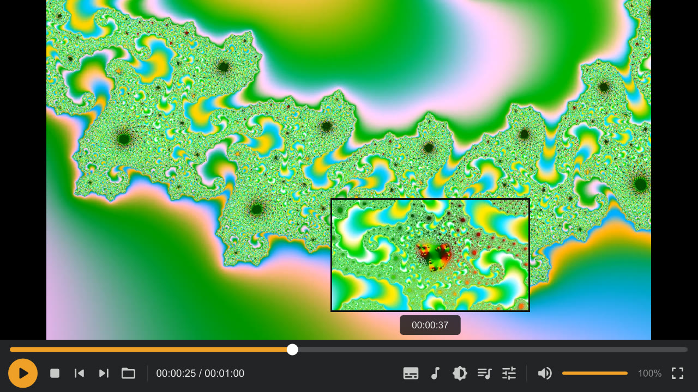
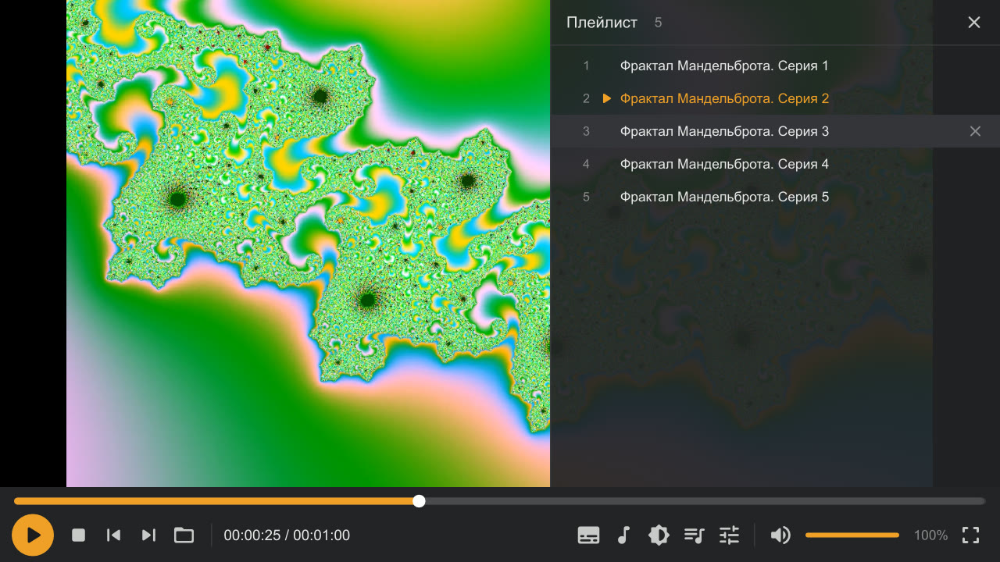
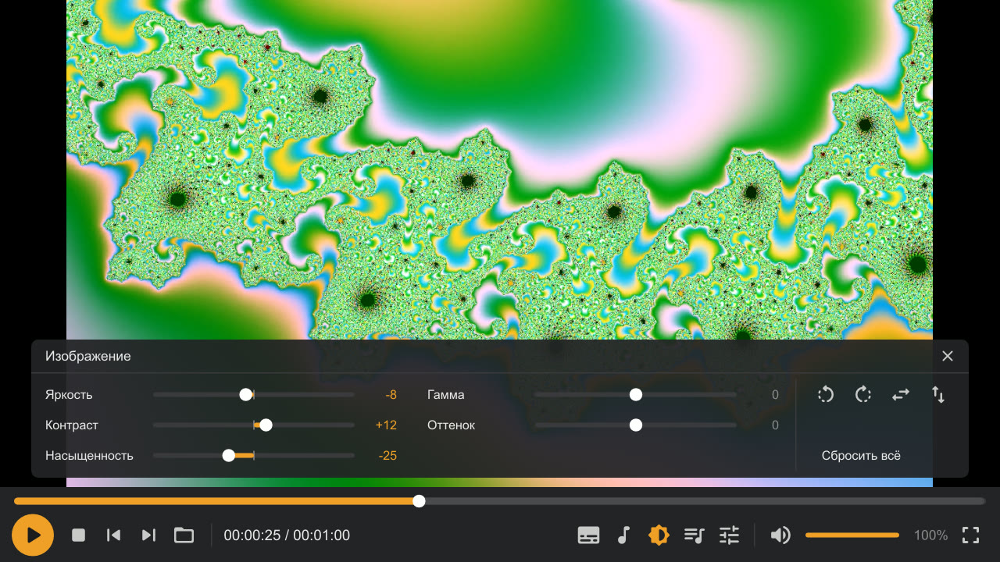

# GomLike

Личный видеоплеер для Windows без рекламы и обновлений: [mpv](https://mpv.io) + своя панель управления в классическом стиле (тёмная, оранжевый акцент), горячие клавиши как в GOM, плейлист из папки по клику колесиком.

## Зачем

Я всегда любил GOM Player: для меня он был самым удобным и самым быстрым плеером. Но в последнее время он оброс рекламой и прочим шлаком. Поэтому я решил сделать свою копию, чтобы всё было как в GOM, только без этого мусора, и собрать её в обычный установщик.

## Скриншоты

Превью кадра при наведении на полосу перемотки:



Плейлист из файлов той же папки (колесико мыши или F8): строки можно перетаскивать и убирать крестиком:



Настройки изображения (F7): яркость, контраст, насыщенность, гамма, оттенок, поворот и отражение:



Меню по правому клику — обычное системное меню Windows, как в GOM.

## Как установить

- **Скачать готовый установщик** из [последнего релиза](https://github.com/batbug/gomlike/releases/latest). Там две версии: `GomLike-Setup-Offline.exe` (всё внутри, интернет не нужен) и `GomLike-Setup.exe` (маленький, скачивает mpv во время установки).
- **Собрать установщик самому** из исходного кода — как это сделать, расписано ниже в разделе [«Сборка»](#сборка).

## Структура

- `player/portable_config/` — всё, что лежит рядом с `GomLike.exe` (это `mpv.exe` с нашим значком: установщик переименовывает его и меняет значок в `getmpv.ps1`):
  - `mpv.conf` — настройки плеера
  - `input.conf` — горячие клавиши (дублированы для русской раскладки)
  - `menu.conf` — меню по правому клику: обычное системное меню Windows, его показывает сам mpv (формат — раздел CONTEXT MENU в руководстве mpv)
  - `scripts/classicbar.lua` — панель управления, плейлист, панель изображения (F7), клик/двойной клик, окно выбора файла Windows
  - `shaders/` — отражение картинки для панели F7 (шейдерами на видеокарте: фильтры `hflip`/`vflip` не работают с аппаратным декодированием)
  - `script-opts/classicbar.conf` — цвета, высота панели, автоскрытие
  - `scripts/uosc/`, `fonts/` — [uosc](https://github.com/tomasklaen/uosc) 5.13.0 (сторонний проект; остался запасным меню субтитров и звука, когда Alt+S / Alt+A нажаты с курсором вне окна, и переходом к соседнему файлу по PgUp / PgDn; LGPL-2.1, `scripts/uosc/LICENSE.LGPL`; одна правка в `elements/Menu.lua`: превью подменю не рисуется, если не помещается в окно, она помечена комментарием `GomLike:`)
  - `scripts/thumbfast.lua`, `script-opts/thumbfast.conf` — [thumbfast](https://github.com/po5/thumbfast) (сторонний проект, MPL-2.0, без изменений, коммит `0f711de313`): превью кадра над полосой перемотки; фоновый процесс для превью запускает тот же `GomLike.exe`
- `player/README.txt` — инструкция для пользователя (кладётся в папку установки)
- `installer/` — установщик на NSIS:
  - `GomLike.nsi` — установка в выбранную папку для текущего пользователя, ярлыки, ассоциации файлов (видео, музыка, плейлисты m3u/m3u8/pls), удаление
  - `getmpv.ps1` — скачивает свежую сборку mpv ([shinchiro/mpv-winbuild-cmake](https://github.com/shinchiro/mpv-winbuild-cmake)): во время установки или при сборке офлайн-версии; рядом с mpv кладёт `mpv-source.txt` с точной версией и ссылками на исходники
  - `licenses/mpv/` — лицензия mpv (GPLv2+), ставится вместе с плеером
- `tools/build.ps1` (Windows), `tools/build.sh` (Linux) — сборка установщиков
- `docs/screenshots/` — скриншоты для README (кадры — сгенерированный фрактал Мандельброта)
- `tools/vtscan.ps1` — проверка собранных установщиков на VirusTotal

## Сборка

Собираются два установщика:

- `installer/GomLike-Setup.exe` (2 МБ) — скачивает mpv во время установки;
- `installer/GomLike-Setup-Offline.exe` (около 38 МБ) — mpv уже внутри, интернет не нужен. mpv для него скачивается при первой сборке в `installer/mpv` и дальше берётся оттуда; свежий — с ключом `-UpdateMpv` (`--update-mpv` в build.sh).

Windows:

```
winget install NSIS.NSIS
powershell -ExecutionPolicy Bypass -File tools\build.ps1
```

Linux:

```
sudo apt install nsis curl p7zip-full
tools/build.sh
```

Для проверки установщика без скачивания mpv: `tools\build.ps1 -Test` (или `makensis -DTEST installer/GomLike.nsi` после подготовки `installer/payload`, см. build.sh) — соберёт `test-setup.exe` с заглушкой вместо mpv.

## Проверка на VirusTotal

Нужен API-ключ VirusTotal (https://www.virustotal.com/gui/my-apikey) в переменной `VT_API_KEY`:

```
setx VT_API_KEY "<ключ>"
powershell -ExecutionPolicy Bypass -File tools\vtscan.ps1
```

Без параметров проверяет оба собранных установщика, занимает несколько минут. Неподписанные установщики NSIS обычно ловят несколько эвристических срабатываний («Malicious», «Unsafe», «PossibleThreat»), это ожидаемо.

## Лицензия

Файлы GomLike — [MIT](LICENSE). Сторонние части со своими лицензиями: [uosc](https://github.com/tomasklaen/uosc) — LGPL-2.1, [thumbfast](https://github.com/po5/thumbfast) — MPL-2.0, [mpv](https://mpv.io) — GPLv2+ (не хранится в репозитории: скачивается установщиком или при сборке офлайн-версии).
